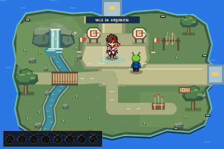

# Mestre da Arquearia — sprite frontal do Overworld

## Integração

- NPC: `mestre_arco_overworld`, cena `ILHA_ARCO`.
- Sprite anterior: `arqueiro_overworld.png?v=1.0_archery_island`.
- Novo sprite: `mestre_arquearia2.0_overworld.png?v=2.0.0_frontal`.
- Posição mantida: **(225, 118)**, na área de treino da nova ilha.
- Nenhuma alteração no desenho da ilha, nas posições dos demais NPCs ou no funcionamento da Arquearia.

## Carregamento e desenho

O carregamento continua em `script.js`, no objeto dedicado `imgMestreArcoOverworld`, com `new Image()` e atribuição de `src` na inicialização, como os demais NPCs existentes.

O NPC mantém `drawNPC()` → `drawUnifiedOverworldNpc()` → `prepareOverworldNpc()`. O recorte é preparado uma vez e guardado no cache de sprites do Overworld (`WeakMap`), usando `overworld_assets/npc_geometry.js`. Não existe fallback para o PNG anterior.

O novo arquivo é uma figura única frontal. Não foram criados frames, slicing de spritesheet, espelhamento, rotação, oscilação ou caminhada falsa.

## Recorte, escala e pés

- PNG original: **1254 × 1254**, RGBA, preservado sem repintura ou alteração física.
- Bounds visíveis usados na medição: **x=333..992, y=89..1160**.
- Recorte com margem de segurança: **[330, 86, 666, 1078]**.
- Padding transparente adicional no Canvas: **2 px**.
- Altura visível de origem: **1072 px**.
- Altura visual em tela: **50 px**.
- Escala uniforme: **50 / 1072 ≈ 0,046642**, sem distorcer proporções.
- Anchor no Canvas preparado: **[291,5; 1077]**.
- Anchor horizontal medido pelo centro dos dois pés (x=619,5 na origem), para que aljava e faixa assimétricas não desloquem o corpo.
- A base dos pés permanece na posição lógica **(225, 118)**.

Cabelo, faixa e suas pontas, aljava, flechas, braços e pés foram preservados no recorte. O PNG mantém sua transparência. O arquivo contém alpha residual muito fraco fora do corpo; a medição de conteúdo usa o mesmo limiar de visibilidade do catálogo existente, com margem de segurança.

## Colisão, sombra e interação

- Footprint físico preservado: **18 × 8**, independente de cabelo, faixa, flechas e aljava.
- Área de interação preservada: **58 × 62**, origem **(196, 70)** e offset padrão de 14 px.
- Sombra padrão da ilha: centrada em **(225, 117)**, raios **13 × 5**, opacidade 0,28.
- Diálogo mantido: “MESTRE DO ARCO: Observe a trajetória, alinhe o disparo e prove sua precisão!”
- Prompt padrão mantido: `MESTRE DO ARCO · [E] / [ESPAÇO] INICIAR`.
- Aproximação mostra a fala/oferta existente; E/Espaço abre o tutorial. Espaço inicia a partida.
- A entrada continua no ramo existente de `update()`: `isMaster === "JOGO_ARCO"` → `currentScene = "JOGO_ARCO"` → `resetArco()`.

## Separação entre assets

- **Overworld:** `mestre_arquearia2.0_overworld.png`.
- **Minigame:** `mestre_arquearia2.0.png`, fonte dos 44 frames do atlas `archery_assets/v2/master_atlas.png`.

O renderer, atlas, manifest, física, IA, pontuação, diálogos e lógica de medalhas do minigame não foram modificados. Os dez arquivos específicos/manifest da Arquearia monitorados mantiveram os hashes do QA anterior.

## Limpeza

- Referência antiga removida do carregamento do NPC e do catálogo ativo de geometria.
- Gerador de metadados atualizado para o novo PNG e anchor dos pés; futuras gerações não restauram a referência antiga.
- Metadados dos outros 16 NPCs permaneceram idênticos.
- Versões de `script.js` e `npc_geometry.js` atualizadas no `index.html`.
- Nenhum arquivo físico antigo foi apagado. Registros históricos de auditoria continuam descrevendo a versão que foi testada na época.

## QA

Chrome real em modo headless, teclado automatizado e save separado. Testados HTTP local e `file://`; capturas inspecionadas visualmente. Não foi uma sessão manual humana.

**Resultado: 25/25 verificações aprovadas.** A partida de integração terminou após 3.600 ticks (60 segundos), em Zorp 0 × 2.532 Mestre, com retorno normal à ilha e save preservado. Zero 404, TypeError, ReferenceError, outros erros ou warnings registrados.

- Entrada pela chegada leste e caminhada até a área de treino.
- Novo sprite frontal, tamanho, recorte, transparência e apoio dos pés.
- Colisão real: pressionar para cima impediu atravessar as pernas do Mestre.
- Sombra padrão, ausência de rotação/espelhamento e reutilização do cache.
- Diálogo/prompt existentes e entrada pelo tutorial.
- Minigame confirmado com a fonte `mestre_arquearia2.0.png` e 44 frames, independente do PNG frontal.
- Partida normal de 60 segundos, seguida de resultado e retorno à ilha.
- Novo NPC conferido novamente após a volta; teste adicional de carregamento/prompt em `file://`.
- Ausência de requisições ao sprite anterior e monitoramento de 404/TypeError/ReferenceError.

Resultados quantitativos finais: ver `archery_master_qa.json` nos artefatos de QA, em `C:/Users/Usuario/.codex/visualizations/2026/10/09/01a1223f-5e07-7c72-9211-5e97ab434100/`.

## Arquivos desta etapa

- `script.js`: troca da origem de `imgMestreArcoOverworld`; única mudança neste arquivo.
- `tools/prepare_overworld_npc_metadata.py`: nova fonte e anchor medido pelos pés.
- `overworld_assets/npc_geometry.json` e `npc_geometry.js`: metadados regenerados.
- `index.html`: versões para evitar cache antigo.
- `docs/archery_overworld_master_v2.md`: relatório.
- `docs/archery_overworld_master_v2.png`: captura do novo NPC na ilha.

