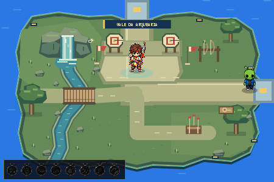

# Ilha da Arquearia — Vale da Arquearia

## Escopo

Atualização exclusiva de `ILHA_ARCO` no Overworld. A Arquearia 2.0, outras ilhas, medalhas, moedas, saves e finais mantêm suas regras.

## Composição

- Contorno orgânico e irregular dentro da escala original de 450 × 300, com borda ciano, base azul escura e pequenos detalhes dourados da linguagem visual do Basquete.
- Gramado claro, grupos discretos de vegetação, três árvores e pedras nas margens.
- Pequena formação rochosa no alto à esquerda; cachoeira ligada a um riacho contínuo até o mar na borda inferior.
- Caminho largo entre a chegada leste, a área do Mestre e a saída norte para a Escalada.
- Uma ponte curta liga a área central ao jardim da margem esquerda.
- Área de treino com dois alvos estáticos, flechas fincadas, marcadores de distância, duas bandeirinhas, suporte com arcos, caixa de equipamento/aljava e placa com pictograma de arquearia.
- Um pássaro comum pousado junto à formação rochosa. Sem alvo pendurado.

Somente cachoeira e correnteza animam. Os alvos, flechas, bandeiras, árvores e pássaro ficam parados. Não existem spawns, explosivos ou entidades de disputa na ilha.

## Mestre e interação

- ID: `mestre_arco_overworld`.
- Posição mantida: **x=225, y=118**.
- Sprite oficial: `arqueiro_overworld.png`, com recorte/metadados já existentes.
- Altura visual: **50 pixels**, bottom-center nos pés; sombra e marca de Mestre preservadas.
- Footprint: **18 × 8**. Área de interação: **58 × 62**, no sistema padrão.
- Prompt existente mantido: `MESTRE DO ARCO · [E] / [ESPAÇO] INICIAR`.
- Interação continua iniciando `JOGO_ARCO` pelo tutorial normal.

## Colisões e navegação

- Os seis volumes decorativos antigos foram substituídos por oito footprints: rocha, dois suportes de alvo, suporte de arcos, equipamento e três troncos.
- Copas e margens transparentes dos PNGs não são usadas como caixas gigantes de colisão.
- Riacho e borda da ilha bloqueiam apenas os pés do jogador. A exceção da ponte usa o mesmo retângulo do desenho: **x=104, y=146, largura=52, altura=24**.
- O caminho principal não atravessa o riacho. Só é preciso usar a ponte para visitar a margem esquerda.
- Conexões mantidas: leste → HUB; norte → Escalada. As regras de transição não foram alteradas.
- O novo teste de terreno só é aplicado quando a cena é `ILHA_ARCO`.

## Performance e cache

- Arte estática em duas camadas Canvas reutilizáveis, de 450 × 300.
- Animação de água limitada a 17 reflexos no riacho e seis faixas na cachoeira; sem emissores ou listas crescentes de partículas.
- Sem novo PNG obrigatório, requisição de asset remoto ou dependência de sprites do minigame para a decoração.
- Versionamento atualizado apenas nos scripts alterados de integração e apresentação.

## Validação no navegador

Chrome real em modo headless, teclado via CDP, capturas visuais e perfil de teste separado. A URL do XAMPP estava indisponível na rodada anterior; foi utilizado servidor local temporário com os arquivos reais do projeto, sem mudar a configuração do Apache. Não se trata de uma sessão manual humana.

**Resultado final: 34/34 verificações aprovadas.** A partida de integração terminou em Zorp 0 × 2.128 Mestre, após 60 segundos completos, seguida de retorno pelo fluxo normal. Não foi necessário vencer novamente para esta validação de integração da ilha; o QA de vitória da Arquearia está documentado separadamente.

1. Entrada leste na ilha: testada.
2. Circulação: percursos reais até Mestre, jardim inferior, margem leste, equipamentos, treino, ponte, jardim oeste, cachoeira e saída norte.
3. Mestre: sprite correto carregado, único NPC da ilha, posição/escala/anchor preservados e prompt visível.
4. Entrada na Arquearia: E abriu o tutorial; Espaço iniciou a partida normal de 60 segundos.
5. Retorno: resultado → Espaço → `ILHA_ARCO`, seguido de movimentação.
6. Colisões: água, ponte, oceano, rocha, alvos, suporte e Mestre conferidos com a função real de colisão.
7. Decoração: comparação de dois instantes confirmou zero mudança nos alvos, bandeiras e pássaro; água e cachoeira mudaram.
8. Outras ilhas: Basquete, Corrida, Surf, Escalada, Skate, Ping-Pong e HUB tiveram funções de desenho e imagens idênticas à referência capturada antes da alteração, usando o mesmo instante para a água.
9. Conectividade: todas as **17.010 posições livres** de uma amostragem a cada dois pixels ficaram conectadas pela hitbox real. Esse teste complementa os percursos de teclado; não significa que cada pixel tenha sido percorrido manualmente.
10. Rede/console: **zero 404, TypeError, ReferenceError, outros erros ou warnings** registrados durante carregamento, navegação, partida e retorno. Resultado consolidado em `archery_island_qa.json` nos artefatos de QA.

Ida e volta pelo HUB e pela Escalada também passaram. O conteúdo do save de teste permaneceu igual antes e depois da integração.

Performance da ilha: amostra sem capturas de 180 intervalos, **59,996 FPS** em média; mediana de 16,7 ms, percentil 95 de 16,8 ms e pior intervalo de 17,1 ms. Essa é uma medição curta no Chrome headless, não garantia de desempenho em todo equipamento.

### Ajustes após o primeiro teste

- A árvore da margem oeste foi deslocada para liberar passagem confortável ao jardim inferior.
- Footprint da formação rochosa refinado para acompanhar o volume da margem.
- O controlador de teste recebeu mais folga nas curvas ao redor do Mestre; a colisão/interação do NPC foi preservada.
- A conferência de conectividade passou a usar a hitbox real, separada da margem extra do controlador automático. Uma janela curta de tecla na volta pelo HUB foi substituída por espera da transição de cena.

## Preservação do minigame

A comparação do `script.js` com a cópia anterior confirma igualdade fora de três pontos autorizados: desenho da ilha, lista de obstáculos da ilha e chamada condicional de colisão do seu terreno. Os dez arquivos específicos da Arquearia/manifest monitorados mantiveram os mesmos hashes do QA anterior.

## Arquivos desta etapa

- `archery_island.js`: nova composição, cache, água, contorno e colisão local.
- `script.js`: integração exclusiva em `ILHA_ARCO`, removendo o desenho e volumes decorativos antigos.
- `overworld_visuals.js`: título da ilha atualizado para `VALE DA ARQUEARIA`.
- `index.html`: carregamento do módulo e versões dos scripts alterados.
- `docs/archery_overworld_valley.md`: este relatório.
- `docs/archery_island_valley.png`: captura da composição final.

