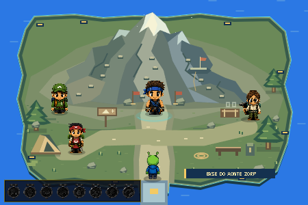

# Ilha da Escalada — Base do Monte Zorp

## Resultado

Atualização exclusiva da ilha `ILHA_ESCALADA` no Overworld. **36/36 verificações aprovadas** no Chrome real com automação de teclado, captura visual e monitoramento de rede/console. Acesso, navegação, colisões, interação e entrada/retorno do minigame passaram, inclusive por `file://`.

## Estrutura visual

- Ilha de 450 × 300, com contorno irregular, borda ciano, base azul escura e luzes douradas na linguagem visual do Basquete.
- Terreno verde baixo junto ao mar, encostas em camadas no interior e grande fachada rochosa ao fundo.
- Montanha com base larga, cristas assimétricas, reentrâncias, faces iluminadas/sombreadas, rachaduras e neve no pico.
- Larguras medidas em três cortes horizontais: aproximadamente **297 px** na base, **178 px** no meio e **31 px** perto do pico. O limite máximo da base é 300 px.
- Três sequências de agarras fixas sugerem caminhos à esquerda, centro e direita. São elementos gráficos, sem entidades ou controles de escalada.
- Pequena saliência intermediária com bandeira e corda, apenas decorativa.
- Caminho principal largo da ponte sul até o Mestre; trilhas laterais para o acampamento.
- Barraca, banco, caixa, mochila, corda enrolada, mosquetões, placa de trilha, pedras e vegetação na base.
- Título deslocado para a parte inferior direita, evitando cobrir o pico.

Os antigos dois paredões retangulares com agarras coloridas e os pequenos triângulos de fundo foram substituídos pela nova formação. Os nove obstáculos antigos da ilha foram substituídos pelos volumes correspondentes à composição atual.

## NPCs

Todos mantêm os sprites oficiais do Overworld, IDs, falas e comportamento de interação existentes. Não foi usada nenhuma spritesheet completa do minigame.

- **Mestre:** `ilha_escalada_mestre_da_escalada`, sprite `npc_mestre_escalada.png`, posição **(225, 168)**, diante da base da montanha. Antes: (225, 108).
- **Guia:** `ilha_escalada_guia_de_trilha`, posição **(87, 166)**. Antes: (80, 140).
- **Geóloga:** `geologa_escalada`, posição **(365, 176)**. Antes: (370, 140). ID e vínculo com o desafio de moedas preservados.
- **Chef:** `ilha_escalada_chef_de_acampamento`, posição **(112, 224)**, junto à barraca. Antes: (95, 220).

Mestre com altura visual de **50 px**; demais NPCs com **44 px**. Bottom-center nos pés, recortes, sombras, footprint de **18 × 8** e metadados de sprite preservados. O Mestre mantém área de interação **58 × 62** e prompt padrão para E/Espaço.

## Colisões

- O contorno físico da montanha segue a mesma silhueta usada no desenho; não existe escalada jogável no Overworld.
- A borda irregular da ilha impede andar no mar. A ponte sul mantém o corredor original de 40 px e a conexão com a Arquearia.
- Sete footprints locais para barraca, banco, caixa/equipamentos, placa e três troncos. Copas e margens transparentes dos PNGs não se tornam hitboxes gigantes.
- Pedrinhas, corda no chão e pequenos detalhes são decoração sem bloqueio, mantendo o acampamento fácil de atravessar.
- Toda a circulação principal fica à frente da montanha. O Mestre pode ser alcançado sem desvios estreitos.
- O teste matemático com a hitbox real, em uma grade de dois pixels, encontrou **12.669 posições livres conectadas**, sem bolsões isolados.
- Após o primeiro teste, duas árvores foram reposicionadas para abrir as passagens laterais. A rodada inteira foi repetida depois do ajuste.

## Animação e desempenho

- Toda a composição estática é guardada em um Canvas de 450 × 300 e reutilizada.
- Apenas uma bandeirinha com variação de um pixel e seis pequenos traços de neve/vento perto do pico se animam.
- Sem pedras caindo, moving holds, spikes, vidas, checkpoints funcionais ou objetos arremessados no Overworld.
- Agarras e acampamento permanecem estáticos. Na comparação de pixels, foi tolerado um nível RGB nas bordas transparentes para não confundir arredondamento do Canvas com animação.
- Amostra sem capturas: **60 FPS** médios em 180 intervalos; percentil 95 de 16,8 ms e pior intervalo de 16,9 ms. É uma amostra curta no Chrome headless, não garantia para todo equipamento.

## Validação

Chrome real em modo headless, com perfil/save de teste separados. Usados servidor HTTP local temporário e o endereço `file:///C:/xampp/htdocs/2025/Festival_Dos_Esportes/index.html`. Não foi uma sessão manual humana.

1. Acesso: Zorp percorreu a Arquearia até a conexão norte e entrou na ilha da Escalada por teclado.
2. Navegação: caminhos reais até Mestre, Guia, Chef, barraca, jardim oeste, Geóloga, equipamentos, banco e margem leste; retorno ao Mestre.
3. Colisões: montanha, mar, barraca, caixa, banco e Mestre bloqueiam; trilha central e ponte sul permanecem livres.
4. Mestre: um único Mestre oficial, escala correta, pés alinhados, diálogo/prompt existentes e interação acessível.
5. Entrada: E abriu o tutorial da Escalada e Espaço iniciou o minigame existente.
6. Retorno: usada uma **derrota controlada pela função de resultado existente**, seguida de Espaço, para conferir a integração. Não foi alegada uma run completa até o cume nesta etapa de Overworld.
7. Após o retorno, Zorp voltou a andar, saiu para a Arquearia e entrou novamente na Escalada.
8. `file://`: fachada e quatro sprites carregaram; interação abriu o tutorial e retorno à ilha funcionou.
9. Silhueta: capturas inspecionadas mostram base ampla, faces, afunilamento, neve e pico. Os três cortes horizontais confirmam a redução de largura.
10. Zero 404, TypeError, ReferenceError, outros erros ou warnings registrados na sessão monitorada.
11. Save, moedas e medalhas do perfil de teste permaneceram iguais antes/depois.

## Preservação de escopo

- Funções de desenho das oito outras regiões permaneceram idênticas: Basquete, Arquearia, Corrida, Surf, Skate, Ping-Pong, Boxe e HUB.
- Comparação visual das outras regiões: imagens iguais no mesmo instante de água; na Arquearia, água animada excluída da comparação e zero diferença na arte estática.
- Hashes de `climb_course.js`, `climb_checkpoints.js`, `climb_presentation.js`, `climb_sprites.js` e `climb_summit.js` permaneceram iguais.
- `overworld_visuals.js` e os metadados compartilhados de NPCs também permaneceram iguais.
- Comparação com a cópia anterior de `script.js` confirmou igualdade fora dos pontos autorizados: desenho/obstáculos da ilha, colisão condicional local e coordenadas dos quatro NPCs da Escalada.
- Nenhuma lógica de minigame, medalha, moeda, save ou final alterada.

## Arquivos desta etapa

- `climb_island.js`: nova arte, silhueta, cache, ambiente e colisão local.
- `script.js`: integração exclusiva da ilha e posições dos seus quatro NPCs.
- `index.html`: carregamento do novo módulo e versão atualizada do script principal.
- `docs/climb_overworld_camp.md`: relatório.
- `docs/climb_island_camp.png`: captura final da ilha.

Artefatos detalhados de QA em `C:/Users/Usuario/.codex/visualizations/2026/10/09/01a1223f-5e07-7c72-9211-5e97ab434100/`: `climb_island_qa.cjs`, `climb_island_qa.json`, `climb_island_scope_verification.json` e capturas `climb_island_*`. As rodadas anteriores foram preservadas separadamente.

