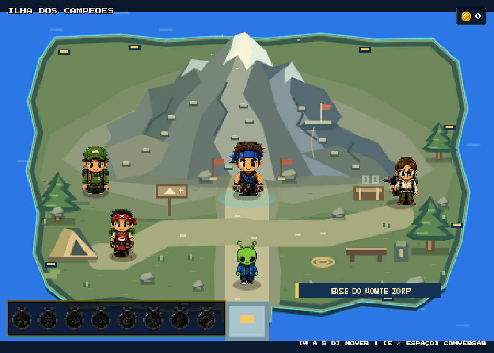

# Auditoria dos NPCs da ilha da Escalada

## Escopo e conclusão

Auditoria da versão atual, sem substituir sprites nem modificar código do jogo. O novo arquivo `npcs_escalada2.0.png` foi localizado e inspecionado, mas **ainda não está cadastrado ou carregado pelo jogo**.

**Não foi reproduzido achatamento por escala X/Y no renderer atual.** As quatro chamadas reais de `drawImage` usam escala uniforme, sem rotação ou espelhamento e com smoothing desligado. Os problemas concretos encontrados são: uso das artes individuais antigas, perda de detalhe na redução para 44–50 pixels e anchors horizontais calculados pelo contorno inteiro, incluindo acessórios.

Não é possível atribuir com certeza o episódio visual anterior da Arquearia a uma versão de código sem a captura/estado daquela versão. As conclusões abaixo dizem respeito ao código e aos pixels atuais da Escalada.

## Ilha e acesso

- Scene: **`ILHA_ESCALADA`**.
- Acesso: saída norte da Arquearia; a volta ocorre pela ponte sul da Escalada.
- Desenho da ilha: `script.js`, função `drawIlhaEscalada()`.
- Arte/contorno/ambiente/colisão local: `climb_island.js`, objeto `ClimbIsland`.
- A fachada não determina largura ou altura dos sprites dos NPCs. Seu desenho é encerrado antes do desenho dos personagens.

## Cadastro atual dos quatro NPCs

### Mestre da Escalada

- ID: `ilha_escalada_mestre_da_escalada`, gerado a partir da scene e do nome.
- Imagem: **`npc_mestre_escalada.png`**, 126 × 194.
- Carregamento: `imgMestreEscalada`, em `script.js:129`.
- Cadastro: `script.js:2811`.
- Posição: **(225, 168)**.
- Altura visível: **50 px**; largura visível: **32,47 px**.
- Escala X = escala Y = **0,2577319588**.
- Crop: **[0, 0, 126, 194]**, padding de 2 px.
- Anchor no Canvas preparado: **[65, 196]**.
- Footprint: **18 × 8**; retângulo físico **[216, 162, 18, 8]**.
- Interação: **[196, 120, 58, 62]**.
- Prompt: `MESTRE DA ESCALADA · [E] / [ESPAÇO] INICIAR`.
- Fala: “O Monte Zorp não perdoa os fracos! Desvie das pedras e alcance o cume!”
- Entrada: `update()` identifica `isMaster: "JOGO_ESCALADA"`, define a scene e chama `resetEscalada()` (`script.js:3092`).

### Guia da Trilha

- ID: `ilha_escalada_guia_de_trilha`, gerado automaticamente.
- Imagem: **`npc_guia_trilha.png`**, 107 × 190.
- Carregamento: `imgGuiaTrilha`, em `script.js:130`.
- Cadastro: `script.js:2812`.
- Posição: **(87, 166)**.
- Altura visível: **44 px**; largura visível: **24,78 px**.
- Escala X = escala Y = **0,2315789474**.
- Crop: **[0, 0, 107, 190]**, padding de 2 px; anchor **[55,5; 192]**.
- Footprint: **18 × 8**; retângulo físico **[78, 160, 18, 8]**.
- Interação: **[65, 132, 44, 48]**.
- Prompt: `GUIA DE TRILHA · [E] / [ESPAÇO] CONVERSAR`.
- Fala: “Cuidado lá em cima! O vento sopra forte e algumas pedras rachadas quebram ao pisar!”

### Geóloga

- ID explícito: **`geologa_escalada`**.
- Imagem: **`npc_geologa.png`**, 143 × 197.
- Carregamento: `imgGeologa`, em `script.js:131`.
- Cadastro: `script.js:2813`.
- Posição: **(365, 176)**.
- Altura visível: **44 px**; largura visível: **31,94 px**.
- Escala X = escala Y = **0,2233502538**.
- Crop: **[0, 0, 143, 197]**, padding de 2 px; anchor **[73,5; 199]**.
- Footprint: **18 × 8**; retângulo físico **[356, 170, 18, 8]**.
- Interação: **[343, 142, 44, 48]**.
- Prompt: `GEÓLOGA · [E] / [ESPAÇO] CONVERSAR`.
- Fala cadastrada: “As pedras azuis deslizam pela montanha, e as vermelhas estão prestes a desmoronar!”
- Ao conversar, `FestivalChallenges.interact()` pode exibir a fala do desafio `escalada_medalha`. Portanto, preservar este ID é importante numa futura migração. Essa lógica não foi alterada ou acionada para conceder moedas nesta auditoria.

### Chef de Acampamento

- ID: `ilha_escalada_chef_de_acampamento`, gerado automaticamente.
- Imagem: **`npc_chef.png`**, 118 × 197.
- Carregamento: `imgChef`, em `script.js:132`.
- Cadastro: `script.js:2814`.
- Posição: **(112, 224)**.
- Altura visível: **44 px**; largura visível: **26,36 px**.
- Escala X = escala Y = **0,2233502538**.
- Crop: **[0, 0, 118, 197]**, padding de 2 px; anchor **[61, 199]**.
- Footprint: **18 × 8**; retângulo físico **[103, 218, 18, 8]**.
- Interação: **[90, 190, 44, 48]**.
- Prompt: `CHEF DE ACAMPAMENTO · [E] / [ESPAÇO] CONVERSAR`.
- Fala: “Uma sopa bem quente para dar energia antes de enfrentar a montanha!”

## Como o desenho funciona

1. `script.js:129` carrega os quatro PNGs individuais com `new Image()`.
2. O array `npcs`, em `script.js:2811`, associa imagem, posição, fala e função de cada personagem.
3. `configureOverworldPresentation()`, em `overworld_visuals.js:167`, aplica 50 px aos Mestres, 44 px aos demais NPCs, footprint e área de interação.
4. `drawNPC()`, em `script.js:3572`, encaminha a Escalada para `drawUnifiedOverworldNpc()`.
5. `prepareOverworldNpc()`, em `overworld_visuals.js:130`, recorta pelos metadados e acrescenta 2 px transparentes de padding. A cópia inicial mantém exatamente a largura e altura de origem; não estica a imagem.
6. `drawUnifiedOverworldNpc()`, em `overworld_visuals.js:144`, calcula **um único fator**: `tamanho / visibleHeight`. Multiplica por ele tanto a largura quanto a altura do Canvas preparado.
7. A posição de desenho desconta `geometry.anchor × scale`. A sombra fica na base lógica, no padrão das ilhas naturais.
8. O cache é um `WeakMap` indexado pelo objeto `Image`; cada PNG individual é preparado uma vez.

Os quatro NPCs **não usam `frameWidth`, `frameHeight`, `sx`, `sy`, `sw` ou `sh`**. Não existe divisão em grade ou animação de spritesheet nesse caminho. Seus `backgroundRectangles` são vazios: nenhuma máscara de remoção de fundo apaga rosto, roupas ou equipamentos.

## Achados sobre aparência e deformação

### 1. As artes novas não estão em uso — confirmado

`npcs_escalada2.0.png` não aparece no carregamento nem no catálogo de geometria, e não foi requisitado no navegador. Portanto, a ilha atual não pode apresentar a aparência dessa nova folha. Isso não é fallback automático: os quatro PNGs antigos ainda são as referências explícitas do cadastro.

### 2. Achatamento X/Y — não reproduzido

As quatro chamadas reais de desenho tiveram X/Y idênticos, matriz `[1,0,0,1,0,0]` e smoothing falso. A proporção visível de cada PNG é preservada. O tamanho total da superfície desenhada inclui padding: por exemplo, o Mestre ocupa um retângulo de aproximadamente 33,51 × 51,03, contendo 32,47 × 50 pixels de personagem. Esse acréscimo transparente não é deformação.

### 3. Perda de detalhe por redução — presente, sem alterar a proporção

Os PNGs de 190–197 pixels de altura são reduzidos para 44–50 pixels, cerca de 3,88 a 4,48 vezes menores. Detalhes finos de rosto, óculos, cabelo e equipamentos podem perder leitura. `imageSmoothingEnabled=false` evita borrão, mas não recupera detalhes descartados pela redução. As posições e dimensões fracionárias também podem mudar a amostragem de pixels, sem provocar achatamento geométrico.

As artes individuais antigas são diferentes das novas; essa diferença de desenho também não é criada pelo renderer.

### 4. Anchor baseado no contorno inteiro — desalinhamento confirmado

O gerador usa o centro horizontal de todos os pixels visíveis para estes quatro NPCs. Ferramentas e mochilas podem deslocar esse centro em relação aos pés.

Estimativa pelo centro dos pixels dos 5% inferiores de cada PNG:

- Geóloga: pés aproximadamente **5,14 px à direita** da posição lógica/sombra.
- Mestre: aproximadamente **1,68 px à direita**.
- Chef: aproximadamente **1,34 px à esquerda**.
- Guia: aproximadamente **0 px**.

Essa medição é uma estimativa pelos pixels da faixa inferior, não um anchor autoral. O efeito é deslocamento horizontal entre corpo, sombra e footprint; **não** alargamento ou achatamento. A base vertical coincide com o último pixel visível, sem flutuação vertical introduzida pelo padding.

### 5. Bordas dos PNGs antigos — sem folga de origem

Os pixels visíveis chegam às quatro bordas dos PNGs antigos. O crop cadastrado usa o PNG inteiro e não corta uma parte adicional do personagem. Qualquer limite já imposto à arte pelo arquivo original não pode ser recuperado com padding no renderer.

### 6. CSS do Canvas — não achata na versão atual

O Canvas possui resolução interna de 450 × 300. Embora sua caixa CSS use `100vw × 100vh`, `object-fit: contain` preserva a proporção do conteúdo, com `image-rendering: pixelated` e sem transform CSS.

Conferidos três viewports: 1280 × 900 → conteúdo 1280 × 853,33; 900 × 900 → 900 × 600; 600 × 900 → 600 × 400. Todos preservam a proporção 1,5. Escala não inteira pode mudar a regularidade dos pixels, mas não estica só um eixo.

## Riscos importantes para uma futura substituição

### Imagem do Mestre compartilhada com o minigame

**`imgMestreEscalada` também é enviada a `ClimbPresentation.summit()` em `script.js:1522`.** Trocar o `src` desse objeto global afetaria o Mestre no cume do minigame. Uma migração restrita ao Overworld precisa separar esse recurso; nada foi trocado nesta etapa.

### Folha nova com quatro personagens

`npcs_escalada2.0.png` tem **1536 × 1024**, RGBA, com transparência. Na ordem visual esquerda → direita: **Geóloga, Mestre, Guia, Chef**. Não são quatro estados de animação do mesmo personagem.

Os personagens ocupam alturas e larguras próprias, com espaço transparente acima/abaixo e contornos claros. Há alpha residual muito baixo fora dos contornos principais. Não é correto desenhar a folha inteira, forçar cada célula num retângulo de 44 × 44 ou remover todo pixel escuro como se fosse fundo.

O sistema atual resolve um recorte pelo caminho do PNG e guarda o cache pelo objeto `Image`. Apontar os quatro NPCs para a mesma imagem sem adaptar os recortes por personagem pode fazer todos usarem o mesmo recorte; sem metadados, o renderer retorna sem desenhar. Uma futura integração precisa de quatro recortes reais independentes e identificação/cache adequados, ou quatro assets extraídos de forma controlada. **Essa integração não foi realizada silenciosamente.**

## Arquivos que controlam os NPCs

- `script.js`: carregamento, cadastro, posição, encaminhamento ao renderer, colisão, prompts e entrada no minigame.
- `overworld_visuals.js`: escala comum, recorte/cache, anchor, sombra e área de interação.
- `overworld_assets/npc_geometry.js`: catálogo executado no navegador.
- `overworld_assets/npc_geometry.json`: versão legível dos metadados.
- `tools/prepare_overworld_npc_metadata.py`: medição de alpha/bounds e geração dos metadados.
- `style.css`: apresentação do Canvas, proporção e ampliação pixelada.
- `climb_island.js`: cenário e colisões locais; não redimensiona NPCs.
- `festival_challenges.js`: fala/desafio adicional da Geóloga; não controla a imagem.

## Validação e arquivos alterados

Inspeção instrumental no Chrome real headless, por `file://`, em perfil separado. Posições de inspeção ajustadas apenas na memória desse perfil para medir desenho e prompts. Não houve substituição de sprite, alteração de lógica, desenho de ilha ou entrada no minigame.

- Quatro imagens carregadas; quatro proporções uniformes confirmadas.
- Quatro prompts corretos observados.
- Novo arquivo não registrado e não requisitado.
- Zero falhas de carregamento ou erros/warnings registrados nessa inspeção.
- Hashes dos 13 arquivos de código/assets auditados permaneceram iguais.

Adicionados somente este relatório e a captura de auditoria. Evidências detalhadas fora do código do jogo: `climb_npc_audit_runtime.json`, `climb_npc_audit_source.json` e `climb_npc_audit_hashes.json`, em `C:/Users/Usuario/.codex/visualizations/2026/10/09/01a1223f-5e07-7c72-9211-5e97ab434100/`.

