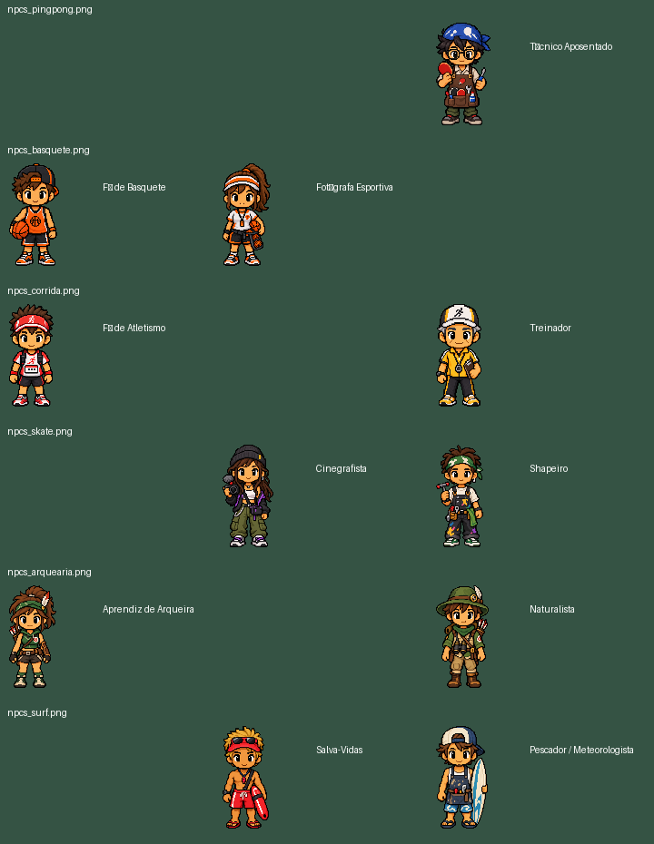

# NPCs normais e missões das oito ilhas

## Entrega

Foram adicionados 11 NPCs normais usando exclusivamente as seis folhas já presentes no projeto. Nenhum Mestre foi substituído. As definições originais dos 20 NPCs anteriores permanecem idênticas: isso inclui todos da Escalada e Boxe, o Aprendiz do Ping-Pong, o Capitão, os dois NPCs do HUB, Ravok e K7. Os seis cenários receberam personagens; nenhuma ilha foi redesenhada.

Cada esporte possui uma única missão principal. O presente de boas-vindas do Guia permanece no HUB. Capitão/Férias e Ravok continuam sendo rotas especiais independentes.

## Auditoria dos assets

As seis folhas possuem 1254 × 1254 pixels e três figuras frontais distintas cada. Não existem poses de costas, esquerda ou direita nem ciclos de caminhada nessas folhas. Os novos NPCs permanecem estáticos, de frente. Não há squash/stretch, inversão, bob ou caminhada inventada.

Os recortes foram medidos por componentes reais da imagem, sem divisão em três células iguais. O catálogo registra também as figuras não usadas; elas não foram adicionadas para preencher quantidade. Os PNGs originais não foram editados nem apagados.

### npcs_pingpong.png

- **Técnico Aposentado** — `tecnico_pingpong`; `ILHA_PINGPONG`; pés em **(83, 108)**; recorte original `[840, 312, 392, 740]`; escala uniforme `0.059459`; altura visível de 44 unidades.

### npcs_basquete.png

- **Fã de Basquete** — `fa_basquete`; `ILHA_BASQUETE`; pés em **(107, 194)**; recorte original `[22, 265, 404, 829]`; escala uniforme `0.053076`; altura visível de 44 unidades.
- **Fotógrafa Esportiva** — `fotografa_basquete`; `ILHA_BASQUETE`; pés em **(345, 197)**; recorte original `[445, 257, 393, 837]`; escala uniforme `0.052569`; altura visível de 44 unidades.

### npcs_corrida.png

- **Fã de Atletismo** — `fa_corrida`; `ILHA_CORRIDA`; pés em **(81, 240)**; recorte original `[29, 243, 377, 870]`; escala uniforme `0.050575`; altura visível de 44 unidades.
- **Treinador** — `treinador_corrida`; `ILHA_CORRIDA`; pés em **(338, 219)**; recorte original `[855, 269, 371, 844]`; escala uniforme `0.052133`; altura visível de 44 unidades.

### npcs_skate.png

- **Cinegrafista** — `cinegrafista_skate`; `ILHA_SKATE`; pés em **(379, 218)**; recorte original `[419, 270, 410, 832]`; escala uniforme `0.052885`; altura visível de 44 unidades.
- **Shapeiro** — `shapeiro_skate`; `ILHA_SKATE`; pés em **(109, 151)**; recorte original `[824, 228, 399, 874]`; escala uniforme `0.050343`; altura visível de 44 unidades.

### npcs_arquearia.png

- **Aprendiz de Arqueira** — `aprendiz_arco`; `ILHA_ARCO`; pés em **(344, 207)**; recorte original `[17, 202, 425, 922]`; escala uniforme `0.047722`; altura visível de 44 unidades.
- **Naturalista** — `naturalista_arco`; `ILHA_ARCO`; pés em **(155, 222)**; recorte original `[805, 254, 449, 870]`; escala uniforme `0.050575`; altura visível de 44 unidades.

### npcs_surf.png

- **Salva-Vidas** — `salva_vidas_surf`; `ILHA_SURF`; pés em **(112, 160)**; recorte original `[444, 231, 390, 863]`; escala uniforme `0.050985`; altura visível de 44 unidades.
- **Pescador / Meteorologista** — `pescador_surf`; `ILHA_SURF`; pés em **(376, 155)**; recorte original `[841, 273, 413, 821]`; escala uniforme `0.053593`; altura visível de 44 unidades.

O mestre de cada ilha mantém seu próprio arquivo anterior. Em especial: `mestre_arquearia2.0_overworld.png`, `npcs_escalada2.0.png` e os arquivos individuais `npc_mestre_novo.png`, `npc_treinador_novo.png`, `npc_arbitro_novo.png`, `npc_pugilista_novo.png` permanecem associados aos NPCs existentes. O Aprendiz continua usando `npc_aprendiz.png`. `capitao.png`, `Ravok.png` e `K7.png` não foram substituídos.

## Renderização, colisão e interação

- O renderer aprovado usa um único fator de escala derivado da altura útil, com `imageSmoothingEnabled = false` e âncora bottom-center medida nos pés. Os novos NPCs usam o mesmo cache de sprites do Overworld.
- Máscaras offline removem transparência residual e matte claro conectado ao exterior. O contorno escuro protege as partes brancas internas de olhos, roupas e calçados. Nenhuma repintura ou keying branco global foi aplicado.
- Todos os novos NPCs têm corpo físico de 18 × 8, separado do PNG. Interação de 44 × 48, deslocada 14 unidades para baixo. Cabelo, flechas, prancha e equipamentos não ampliam a colisão física.
- Na ilha do Basquete, apenas os dois NPCs novos passam pelo renderer comum e pela nova colisão corporal; o desenho do Mestre permanece no caminho original.
- A seleção usa o NPC mais próximo entre os prompts elegíveis. Todos os oito Mestres continuam acessíveis e abrem seus briefings reais.
- E/Espaço abre a conversa. Durante diálogos comuns, o movimento fica congelado; E/Espaço/Esc fecha e limpa comandos armazenados. Capitão e Ravok preservam seus controladores próprios.
- Segurar E/Espaço não fecha e reabre diálogos de NPCs normais do Basquete. O avanço exige uma nova borda de tecla; a interação anterior do Mestre permanece disponível.
- O Naturalista foi movido para (155, 222), fora da ponte e da faixa do rio. As aproximações de todos os NPCs foram percorridas com a colisão real no navegador.

## Uma missão por ilha

- **Ping-Pong — missão existente do Aprendiz:** conquistar a medalha e retornar; 25 moedas. O Técnico Aposentado é apenas ambiental.
- **Basquete — A FOTO DO ANO:** a Fotógrafa recebe o registro de uma cesta física válida de três pontos de Zorp com mais de zero e no máximo dez segundos restantes. Vitória não é requisito; 30 moedas ao retornar. O Fã é ambiental.
- **Corrida — VOLTA LIMPA:** o Treinador recebe uma volta validada pelo START, CP1, CP2, CP3 e FINISH físicos. Colisão efetiva com obstáculo ou objeto arremessado invalida apenas a volta atual. Barreiras corretamente saltadas não invalidam. A volta seguinte começa limpa; 25 moedas ao retornar. O Fã comenta a competição.
- **Skate — UMA TOMADA SÓ:** grind real com pelo menos 12 unidades de contato, seguido de manobra aérea concluída e aterrissagem segura GOOD/PERFECT, sem queda entre as ações. Reinício limpa a sequência; 30 moedas ao retornar. O Shapeiro não oferece missão.
- **Arquearia — TRÊS NO VENTO:** três acertos diretos nos discos carregados, na mesma partida. A identificação de uma flecha dirigida ao disco usa a direção liberada e a posição/velocidade então observável do alvo; isso não altera a trajetória, a IA nem a hitbox. Uma falha de flecha dirigida a esses discos reinicia a sequência; flechas alheias não. Resolução mantém a ordem de disparo e impede duplicação. Acertos colaterais por explosão não contam; 30 moedas ao retornar ao Naturalista. A Aprendiz é ambiental.
- **Escalada — missão existente da Geóloga:** conquistar a medalha e retornar; 25 moedas. Guia, Chef e Mestre preservados. Nenhum NPC adicional.
- **Boxe — missão existente do Pugilista/Apostador:** vencer a luta completa sem knockdown e retornar; 40 moedas. Treinador, Árbitro e Mestre preservados. Nenhum NPC adicional.
- **Surf — CONTRA A CORRENTE:** alcançar 60% do percurso na mesma run sem TUBE_CAPTURE/CAUGHT antes desse marco. Captura é registrada mesmo se a transição ocorrer no mesmo frame. Uma nova run recomeça limpa; 30 moedas ao retornar ao Salva-Vidas. Pescador/Meteorologista é ambiental; Capitão continua na rota de Férias.

### Avaliação da aterrissagem do Skate

A auditoria confirmou que o Skate atual não possuía graduação GOOD/PERFECT de aterrissagem. Foi acrescentada apenas a anotação da missão: manobra interrompida gera ROUGH; manobra concluída antes do contato gera GOOD; com ao menos 120 ms entre conclusão e contato, PERFECT. A aterrissagem exige o contato físico real e ausência de CRASH. Nenhum impulso, pontuação, controle de rampa ou regra de grind foi alterado.

## Diálogos

Os novos donos distinguem oferta/aceitação, missão em andamento, cumprimento com recompensa pendente e agradecimento após pagamento. A recompensa é entregue na interação de retorno. A medalha também modifica o comentário dos novos donos e dos NPCs ambientais. Não existem missões nas falas do Técnico, Fãs, Shapeiro, Aprendiz de Arqueira ou Pescador/Meteorologista.

## Save e flags

O save canônico continua em **`localStorage["zorp_festival_wallet"]`**, versão 3 existente. Não foi criado um segundo saldo nem um save paralelo. Cada entrada de `challenges` guarda `accepted` (= questAccepted), `completed` (= questCompleted), `claimed` (= rewardClaimed) e `evidence`.

IDs novos:

- `basquete_foto_ano` → `sideQuestBasketPhotoComplete`;
- `corrida_volta_limpa` → `sideQuestRunningCleanLapComplete`;
- `skate_uma_tomada` → `sideQuestSkateOneTakeComplete`;
- `arco_tres_vento` → `sideQuestArcheryWindComplete`;
- `surf_contra_corrente` → `sideQuestSurfCurrentComplete`.

As cinco flags públicas são getters derivados do estado persistido, evitando cópias divergentes. `pingpong_medalha`, `escalada_medalha`, `boxe_sem_quedas` e `guia_boas_vindas` mantêm seus IDs. Pagamento e claimed são gravados juntos pela carteira existente; repetir conversa ou reload não permite farm.

## QA

- **262/262 testes de regressão aprovados**, incluindo 17 novos testes específicos; arquivo `regression.tap`.
- **34/34 verificações de navegador aprovadas** na integração final, em Chrome real isolado, servindo diretamente os arquivos do projeto; `browser-qa.json`.
- Oito ilhas visitadas. Aproximações calculadas pela colisão real e percorridas chamando o update de movimento real; E/Espaço enviados pelo teclado do navegador. Todos os NPCs respondem; todos os Mestres abrem briefing e retornam pelo cancelamento normal.
- Objetivos testados com configurações controladas: cesta atravessando o aro, circuito por gates físicos, três colisões swept em discos de pássaros, grind/saída/manobra/aterrissagem físicos e atualização real do Surf no marco de 60%. Não se trata de uma afirmação de oito campanhas completas jogadas manualmente.
- As cinco missões novas sobreviveram a reload completas e não pagas. Retorno aos cinco donos pagou exatamente uma vez. As três missões anteriores também pagaram uma vez pelo fluxo preservado. Total de 235 moedas no perfil de QA, sem presente do HUB; novo reload manteve saldo e oito claimed.
- Para as missões anteriores, as medalhas de Ping-Pong/Escalada foram ativadas no perfil de desenvolvimento e o Boxe recebeu um resultado controlado de 2–0 sem knockdowns pela função real de finalização; não foram declaradas lutas completas manuais nesta etapa.
- As 11 escalas X/Y foram comparadas numericamente: iguais, altura útil de 44 e pés coincidentes com a posição lógica. Sem troca de sprite por fallback.
- Performance final: **59.02 FPS** em amostra de 120 intervalos no Overworld.
- Execução final: zero 404/erros HTTP, falhas de rede, avisos/erros de console, TypeError e ReferenceError. Uma falha de conexão transitória de um asset de Surf no servidor inicial de QA foi rastreada; a validação final usou HTTP/1.1 e fila adequada de conexões. O asset existia e não exigiu mudança no jogo.
- O save e a janela do jogador não foram usados. Os testes utilizaram um perfil de navegador separado.

## Observações anteriores preservadas

A auditoria identificou duas falas legadas fora dos NPCs novos: o treinador antigo do Boxe ainda menciona L/I para guarda/esquiva, e o Mestre da Corrida menciona duas voltas. Elas foram mantidas para respeitar a solicitação de preservar os NPCs completos do Boxe e as definições existentes dos Mestres. As novas falas e missões utilizam as regras atuais. A corrida física continua com exatamente três voltas e os controles reais do Boxe não foram alterados.

## Arquivos

Modificados: `script.js`, `overworld_visuals.js`, `festival_challenges.js`, `index.html`, `basketball_1v1.js`, `corrida_maratona.js`, `surf_endless.js`, `skate/skate_ollie_runtime.js`.

Adicionados: `normal_island_npcs.js`, `normal_npc_geometry.js`, `normal_npc_geometry.json`, `island_npcs.test.cjs`, `tools/prepare_normal_island_npcs.py` e evidências nesta pasta.

`scope-check.json` registra hashes dos PNGs e sistemas protegidos. Os diffs desta pasta mostram somente as alterações da etapa, sem misturar os trabalhos anteriores do projeto.

`npc-inventory.json` contém o inventário dos 31 NPCs registrados, incluindo os anteriores: função, ilha, fonte real, dimensões, posição, recorte, escala e interação. Ravok/K7 mantêm seu atlas direcional próprio. `normal_npc_geometry.json` registra os detalhes de todas as 18 figuras das seis folhas, das quais 11 foram utilizadas.

