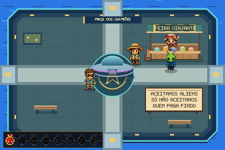
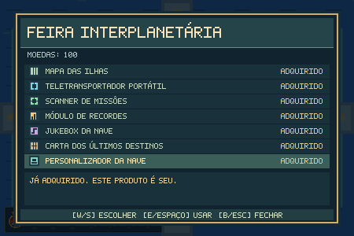
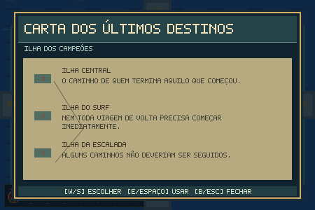

# Comerciante da Ilha Central — campanha, loja e mochila

## Presença e progressão

Com zero medalhas não são desenhados Comerciante, loja ou placa. Seus colliders também ficam inativos. O setor superior direito foi reservado para a futura loja: o canteiro desse setor foi retirado e o banco direito foi deslocado de (336, 211) para (336, 240). Nenhuma outra ilha foi redesenhada.

Após a primeira medalha, a chegada é preparada na próxima oportunidade segura no Overworld. Resultados de minigame, briefings, abertura, diálogos e cutscenes existentes têm prioridade. Saves anteriores com medalha e sem a chegada também entram nesse fluxo. O jogador não recebe controle intermediário enquanto a apresentação começa.

A sequência dura cerca de 21 segundos, mais o tempo de leitura: fade; corte para o HUB; caminhada com bolsa; observação; bolsa no chão e animação de procura; balcão; cobertura; produtos; reação de surpresa e enquadramento da nave de Zorp; caminhada até a placa; instalação; retorno ao balcão; satisfação e fala final. Espaço avança somente a fala final após uma pequena espera; não pula as etapas essenciais.

A fala final é “Pronto. Clientela interplanetária garantida.” Depois de salvar, o jogador recupera sua posição e ilha anteriores. A apresentação mostra o HUB sem obrigar um teletransporte de gameplay.

## Posições, layers e colisão

- Comerciante: ID `comerciante_central`, `HUB`, pés em **(342, 111)**. Corpo físico 18 × 8. Interação 58 × 70, deslocada para a frente do balcão; E/Espaço abre a conversa.
- Loja desenhada integralmente por Canvas, aproximadamente **(289, 48) a (405, 125)**: cobertura, postes, balcão de madeira, caixa, bolsa e produtos.
- Placa em **(290, 175)**, 116 × 49, com apoios até y=229. Alto contraste e fonte bitmap local de 5 × 7, incluindo acentos desenhados em pixels.
- Texto permanente e exato: **ACEITAMOS ALIENS / SÓ NÃO ACEITAMOS / QUEM PAGA FIADO**. Cada trecho ocupa sua própria linha.
- Collider da loja: `(303, 99, 93, 21)`; apoio da placa: `(292, 222, 113, 5)`. Não há collider antes do desbloqueio.
- Layers: parte posterior/cobertura, Comerciante, frente do balcão, demais atores por Y e placa. O balcão oculta naturalmente a parte inferior do vendedor; rosto e chapéu ficam livres. A placa não fica atrás da loja.
- As quatro saídas, a aproximação frontal do vendedor e a área diante da placa permaneceram conectadas no grafo da colisão real.

## Sprite e animações

Fonte original preservada: **`npc_comerciante.png`**, 1254 × 1254. Foram identificados 50 componentes reais de personagem; os rótulos impressos e o fundo preto não fazem parte dos recortes. Componentes vizinhos que se sobrepõem em suas caixas foram separados por identidade, sem cortar mãos ou acessórios.

O atlas derivado transparente é `merchant_walk_atlas.png`. O catálogo `merchant_atlas.json` registra todos os sourceRects no PNG original e as posições no atlas. O arquivo original não foi modificado.

Escala única: **0.273291925**, equivalente a 44 unidades na altura do idle frontal de referência. Todos os frames compartilham canvas 190 × 190 e âncora de pés **(95, 184)**. A largura/altura de desenho permanece constante em idle, caminhada, diálogo e vendas; não existe squash/stretch. Variações desenhadas no próprio frame são preservadas, sem reescalar cada pose.

Caminhada física: **40 unidades/segundo**, com deltaTime; animação a **7 FPS**, timer separado. Direção predominante seleciona walk up/down/left/right. Desenho em coordenadas inteiras e `imageSmoothingEnabled = false`.

Animações mapeadas:

- `idle_down`: 3 frames.
- `idle_up`: 3 frames.
- `idle_left`: 3 frames.
- `idle_right`: 3 frames.
- `walk_down`: 4 frames.
- `walk_up`: 4 frames.
- `walk_left`: 4 frames.
- `walk_right`: 4 frames.
- `present`: 4 frames.
- `beckon`: 3 frames.
- `coins`: 3 frames.
- `bag`: 4 frames.
- `talk`: 3 frames.
- `happy`: 3 frames.
- `surprised`: 2 frames.

No mundo há idle e convite periódico ao se aproximar; conversa usa talk; oferta e confirmação usam present; venda executa present → coins → happy; pouco dinheiro usa surprised. A chegada usa walk, idle de observação, bag, present, surprised e happy. Nenhuma animação foi simulada por deformação.

## Loja e preços

Preços ficam exclusivamente em `merchant_config.js`. Todos os itens são opcionais, permanentes e vendidos uma única vez:

- **MAPA DAS ILHAS — 15 moedas**, `USABLE_INTERFACE`. Mochila → USAR; desbloqueia M. Sem o item, M só informa “Você ainda não possui um mapa.”
- **TELETRANSPORTADOR PORTÁTIL — 35 moedas**, `USABLE_INTERFACE`. Lista apenas ilhas visitadas. Também integra o mapa quando ambos os itens estão comprados. Revalida posse, visita e ponto seguro antes de viajar; exige confirmação e faz fade.
- **SCANNER DE MISSÕES — 20 moedas**, `PASSIVE_UPGRADE`. Acrescenta ao mapa apenas MISSÃO DISPONÍVEL, EM PROGRESSO ou CONCLUÍDA. Não mostra objetivos secretos; usa o estado canônico das missões existentes.
- **MÓDULO DE RECORDES — 15 moedas**, `USABLE_INTERFACE`. Mostra somente modalidades iniciadas ou comprovadas por medalhas antigas. Guarda pontos/altura/rounds e, na Maratona, o menor tempo de chegada fisicamente registrado.
- **JUKEBOX DA NAVE — 15 moedas**, `LOCATION_UNLOCK`. Acessível na nave por F. Toca apenas temas desbloqueados pelas visitas.
- **CARTA DOS ÚLTIMOS DESTINOS — 25 moedas**, `USABLE_INTERFACE`. Descrição: “Um mapa antigo do arquipélago coberto por marcas estranhas. Alguns caminhos parecem terminar onde outros começam.”
- **PERSONALIZADOR DA NAVE — 20 moedas**, `LOCATION_UNLOCK`. F perto da nave permite escolher ORIGINAL, AURORA ou SOLAR. Altera faixas/luzes da nave no Overworld, sem modificar colisões, velocidade, atributos ou requisitos de final.

Total atual da loja: **145 moedas**. No teste, partir de 245 e comprar todos os itens deixou **100 moedas**, disponíveis para a decisão de pagar o Capitão. Nenhum item nem o pagamento do Capitão acontece automaticamente.

## Moedas, compra e save

O saldo continua pertencendo à carteira global existente. Confirmações de compra começam em CANCELAR. Compra verifica a configuração, desbloqueio, posse e saldo; cobrança e `purchasedItems[itemId] = true` são gravados juntos no mesmo registro. Falha de gravação desfaz a cobrança e a posse. Repetir a tecla, manter a tecla pressionada, conversar novamente ou recarregar não permite duplicar o item.

Persistência: **`localStorage["zorp_festival_wallet"]`**, migrada para versão 4, preservando saldo, missões, recompensas recebidas e estados do Capitão. O novo objeto `commerce` contém:

- `merchantArrivalSeen` e `merchantUnlocked` — ambos somente após terminar e salvar a chegada;
- `purchasedItems`;
- `visitedIslands` e `playedSports`;
- `records` e `heardTracks` (catálogo musical desbloqueado);
- `shipStyle` e `firstPurchaseSeen`.

Em falha de save na conclusão da chegada, a cena aguarda nova tentativa e não marca o evento como visto. Reload antes da conclusão repete a apresentação; reload depois da conclusão mantém a loja e não repete o evento. O reset existente do jogo já apaga a carteira pelo prefixo `zorp`.

Medalhas de saves antigos comprovam visita/jogo na ilha correspondente. O histórico armazenado de Surf também é importado. Pontuações históricas que o jogo nunca salvou não são inventadas: o painel mostra SEM REGISTRO SALVO até uma nova partida. A partir da integração, o módulo coleta os oito minigames pelo fluxo real de início/retorno.

## Mochila e controles

- **B** abre/fecha a mochila no Overworld. API global: `FestivalBackpack.open()`, `.items`, `.use(id)` e `.owns(id)`.
- **M** abre o mapa quando adquirido.
- **F** perto da nave acessa Jukebox/Personalizador instalados. E e o fluxo original de retorno para casa permanecem disponíveis.
- **W/S ou setas** escolhem opções. E/Espaço/Enter confirma. B/Esc fecha. O teletransporte e as compras têm confirmação separada.
- Diálogo, loja, mochila e interfaces de itens bloqueiam movimento e limpam comandos pendentes. B/M não abrem interfaces em nenhum minigame.

## Personalidade, pistas e música

Existem falas diferentes para 1, 2–3, 4–5, 6–7 e 8 medalhas, além de reações à primeira compra, falta de saldo, compra de maior valor, Carta, 100+ moedas e nave de Zorp. O vendedor é simpático e experiente; não aplica taxas ocultas nem vende o mesmo produto novamente.

A Carta apresenta somente:

- Ilha Central: “O caminho de quem termina aquilo que começou.”
- Ilha do Surf: “Nem toda viagem de volta precisa começar imediatamente.”
- Ilha da Escalada: “Alguns caminhos não deveriam ser seguidos.”

A interface da Carta não menciona FINAL, Ravok nem Capitão, e não explica como concluir as rotas.

Não havia arquivos de trilha musical no projeto. A Jukebox usa quatro temas originais curtos sintetizados por Web Audio, sem download/dependência externa: Feira Viajante, Festival dos Campeões, Brisa do Arquipélago e Trilha da Montanha. As visitas desbloqueiam o catálogo correspondente; a reprodução só ocorre ao escolher uma faixa na nave. Fechar o painel interrompe música e libera as vozes. Efeitos e áudio dos minigames foram preservados.

## QA

- **204/204 testes de regressão aprovados**, incluindo **15 testes novos** de chegada, animação, transações, falha de save, inventário, viagem, recordes e diálogos.
- **22 verificações integradas de navegador aprovadas** (16 do percurso completo e 6 adicionais). Chrome real, perfil separado e arquivos servidos diretamente do projeto.
- Chegada completa executada em tempo real; registradas todas as etapas, mais de oito frames diferentes de caminhada e escala X/Y constante. Primeiro resultado de Ping-Pong usado como fixture controlada: medalha confirmada pela função existente e retorno pelo fluxo normal; não se trata de campanha completa jogada manualmente.
- As sete compras foram feitas pelo teclado e pela confirmação real da loja. Testados saldo insuficiente, item já comprado, sequência visual da venda e 100 moedas restantes.
- Testados mochila vazia/cheia, M bloqueado/liberado, recusa de ilha não visitada, confirmação/fade de viagem para ilha visitada, landing livre, scanner, Carta, recordes, Jukebox e cores da nave.
- Reload manteve chegada, sete itens, saldo, visitas, recordes e customização, sem nova cutscene.
- Save legado versão 3, com 73 moedas e recompensa anterior já recebida, disparou a chegada uma vez e manteve o saldo e a recompensa.
- B/M foram pressionados nas oito cenas de minigame sem abrir a mochila/mapa. A telemetria de recordes foi exercitada nos oito tipos, incluindo tempo menor como melhor resultado na Corrida.
- Performance observada: **60.00 FPS** em amostra de 120 intervalos no HUB.
- **Zero 404, falhas de rede, avisos/erros de console, TypeError e ReferenceError** nas verificações finais.
- O save e o navegador do jogador não foram utilizados. Instâncias isoladas de QA foram encerradas após os testes.

## Arquivos

Modificados: `script.js`, `index.html`, `festival_economy.js`, `overworld_visuals.js`.

Adicionados: `merchant_config.js`, `merchant_atlas.js`, `merchant_atlas.json`, `merchant_walk_atlas.png`, `merchant_animation.js`, `merchant_campaign.js`, `merchant_ui.js`, `merchant_music.js`, `merchant_campaign.test.cjs` e evidências nesta pasta.

O sprite original, os NPCs existentes, as missões, as medalhas e os arquivos das rotas padrão/Férias/Ravok permanecem preservados. `scope-check.json` contém hashes dos arquivos protegidos e da integração. Os diffs desta pasta isolam as alterações desta etapa.

